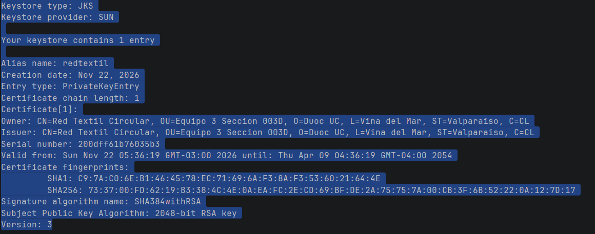

# 1. Red Textil Circular

App móvil Android para la **Fundación Textil Circular** (Región de Valparaíso), con su microservicio Spring Boot.
Proyecto de la asignatura **DSY1105 · Desarrollo de Aplicaciones Móviles**, Duoc UC sede Viña del Mar. Evaluación Parcial 4.

Resuelve el caso **"Gestión de Perfil, Catálogo Gráfico y Contactos para la Red Textil Circular"**. La Fundación administra el Directorio Textil Circular, con más de 980 emprendedoras textiles de las 16 regiones de Chile (suprarreciclaje, reparación, segunda mano, arriendo, talleres, accesorios y tejido). Hoy lo hace con Google Forms, Sheets y WordPress, y eso genera fichas invisibles, enlaces rotos, fichas sin fotos y gestión manual. La app reemplaza ese flujo: la emprendedora se registra y completa su ficha validada, sube fotos de sus trabajos y responde consultas. La administradora gestiona altas y bajas, métricas y correos. El cliente busca y contacta desde el directorio.

| | |
|---|---|
| **Paquete** | `cl.duoc.redtextil` |
| **Plataforma** | Android 7.0 (API 24) o superior · `targetSdk 35` |
| **Microservicio** | Spring Boot 3.5 · Java 17 · H2 · `http://localhost:8080/api` |
| **API externa** | [mindicador.cl](https://mindicador.cl) (dólar, euro y UF del día) |

---

## 2. Integrantes

| Integrante | Sección · Equipo |
|---|---|
| Luis Felipe Mallada | 003D · Equipo 3 |
| Cristóbal Stenger | 003D · Equipo 3 |
| Alex Aburto | 003D · Equipo 3 |
| Cristóbal Ramos | 003D · Equipo 3 |

**Docente:** Nancy Beatriz Bernal Sanchez

---

## 3. Funcionalidades

La barra superior tiene un **selector de perfil** para cambiar en vivo entre los tres tipos de usuaria:

**Modo Emprendedora** (Mi perfil · Mi ficha · Catálogo · Consultas)
- Registro con validación visual campo a campo (RUT con dígito verificador, correo, teléfono +569, región y comuna, consentimiento de privacidad) y correos automáticos de bienvenida y confirmación.
- Ficha de 32 campos en 5 secciones desplegables, con preguntas condicionales (formalización, atención presencial, donaciones, talleres, arriendo) y tope de 2 rubros.
- **Catálogo fotográfico (CRUD completo con el microservicio):** crear, ver, editar y eliminar trabajos. Las fotos se toman con la cámara o se eligen de la galería, se comprimen (máximo 1080 px, JPEG al 75 %) y se suben al servidor.
- **Bandeja de consultas (CRUD con el microservicio):** recibir las consultas del servidor, responderlas, marcarlas como pendientes o respondidas y eliminarlas con confirmación. Botón directo a WhatsApp.

**Modo Directorio Cliente** (Buscar · Mis consultas)
- Búsqueda por texto con filtros combinados de región, comuna y rubro.
- **Tarjeta "Indicadores del día"** con el dólar, el euro y la UF de **mindicador.cl** (API externa), con estados de carga, error y reintento.
- Ficha ampliada con galería y **precio de cada trabajo convertido a dólares** con el dólar observado del día.
- Contacto por WhatsApp o Instagram (se registra el clic) y formulario de consulta validado.

**Modo Administradora** (Fichas · Métricas · Correos)
- Recibe las fichas del microservicio y permite aprobar, observar (con nota validada) o dar de baja. Revisa la consistencia de cada ficha.
- Integra el dataset histórico de 982 emprendimientos desde el microservicio. Si no hay conexión, lo hace desde el respaldo local y lo depura sin pedir un nuevo registro.
- Métricas de búsquedas y contactos por las 16 regiones y los 7 rubros, y seguimiento de los correos automáticos (enviados, en cola o fallidos), con reenvío.

**Transversal**
- **Offline-first:** todo se guarda primero en Room y se sincroniza con el microservicio apenas hay señal. El botón **Actualizar** de cada pantalla trae los cambios del servidor, y el menú ⋮ → *Simular sin señal* permite probar la zona rural.
- Si el servidor ya no tiene un registro, la app lo vuelve a crear. El servidor no duplica fichas, trabajos ni consultas cuando la app reintenta un envío con mala señal.
- Notificaciones locales (nueva consulta, registro, cambio de estado y sincronización) y animaciones con propósito.
- 172 pruebas unitarias de ViewModel y Repository (JUnit + MockK), con un 99 % de cobertura de la lógica.

---

## 4. Endpoints utilizados

### 4.1 Microservicio propio (Spring Boot)

URL base: `http://localhost:8080/api`. Desde el emulador es `http://10.0.2.2:8080/api/` (ver `data/remote/ApiClient.kt`).

| Método | Endpoint | Uso en la app |
|---|---|---|
| GET | `/fichas?region=` | Admin y sincronización: recibir las fichas |
| GET | `/fichas/{id}` | Obtener una ficha |
| POST | `/fichas` | Registro de una cuenta nueva (si el RUT ya existe, se actualiza esa ficha) |
| PUT | `/fichas/{id}` | Guardar *Mi ficha*, aprobar, observar o dar de baja |
| DELETE | `/fichas/{id}` | Borrar la ficha con su catálogo y sus consultas |
| GET | `/catalogo?fichaId=` | Recibir el catálogo de la emprendedora |
| GET | `/catalogo/{id}` | Obtener un trabajo |
| POST | `/catalogo` | Crear un trabajo |
| PUT | `/catalogo/{id}` | Editar un trabajo |
| DELETE | `/catalogo/{id}` | Eliminar un trabajo y su foto |
| POST (multipart) | `/catalogo/{id}/foto` | Subir la foto ya comprimida |
| GET | `/catalogo/{id}/foto` | Descargar la foto (la app la muestra por URL) |
| GET | `/consultas?fichaId=` | Recibir la bandeja de consultas |
| GET | `/consultas/{id}` | Obtener una consulta |
| POST | `/consultas` | Enviar una consulta desde el directorio |
| PUT | `/consultas/{id}` | Responder o cambiar el estado |
| DELETE | `/consultas/{id}` | Eliminar una consulta |
| POST | `/metricas/interacciones` | Lote de búsquedas y clics (trazabilidad) |
| GET | `/metricas/interacciones?fichaId=` · `/metricas/resumen` | Consultar las métricas guardadas |
| POST | `/correos/enviar` · GET `/correos` | Correos automáticos (sin SMTP real: quedan registrados como enviados) |
| GET | `/historico/emprendimientos` | Dataset histórico de 982 emprendimientos |

Los errores responden `{"ok": false, "mensaje": "..."}` con código 400 (datos inválidos) o 404 (no existe).

### 4.2 API externa (Retrofit)

| Método | Endpoint | Uso en la app |
|---|---|---|
| GET | `https://mindicador.cl/api` | Dólar observado, euro y UF del día para la tarjeta del Directorio y el precio en US$ del catálogo |

Usa su propio cliente Retrofit (`data/remote/MindicadorApi.kt`) y su repositorio (`IndicadoresRepository`). Los datos se guardan solo en memoria: no pasan por Room ni por el microservicio.

---

## 5. Pasos para ejecutar

**Requisitos:** Android Studio Ladybug (2024.2) o superior, con Android SDK Platform 35, y JDK 17 o superior (sirve el que trae Android Studio).

### 5.1 Levantar el microservicio

```bash
cd backend
./mvnw spring-boot:run          # en Windows: mvnw.cmd spring-boot:run
```

- Queda en `http://localhost:8080/api`. Al iniciar por primera vez carga las 982 fichas históricas.
- La base de datos H2 se guarda en `backend/data/`. Para revisar las tablas, abre `http://localhost:8080/api/h2-console` con la JDBC URL `jdbc:h2:file:./data/redtextil`, el usuario `sa` y sin clave.
- Pruebas del microservicio: `./mvnw test` (12 pruebas con MockMvc).

### 5.2 Ejecutar la app

1. Abrir la carpeta raíz del proyecto en Android Studio y esperar la sincronización de Gradle.
2. Con el microservicio levantado, ejecutar en un emulador (botón ▶ Run). El emulador llega al computador por `10.0.2.2`.
3. En un **teléfono físico**, cambiar `BASE_URL` en `data/remote/ApiClient.kt` por la IP del computador (por ejemplo `http://192.168.1.10:8080/api/`) y agregar esa IP en `res/xml/network_security_config.xml`.
4. Si ya tenías instalada una versión anterior de la app, desinstálala para partir con la base de datos nueva. Al abrirla, las cuentas demo se suben solas al microservicio.

Guía rápida para probarlo todo:

1. **Emprendedora → Mi perfil:** elegir *Renace Textil* o crear una cuenta nueva.
2. **Catálogo:** crear un trabajo con foto, editarlo y eliminarlo. Revisar el cambio en `GET /api/catalogo` o en la consola H2.
3. **Directorio cliente:** ver la tarjeta de indicadores (mindicador.cl), abrir una ficha (precios en US$) y enviar una consulta.
4. **Emprendedora → Consultas:** tocar *Actualizar*, responder la consulta y luego eliminarla.
5. **Administradora:** *Actualizar* fichas, aprobar u observar, integrar el dataset histórico, y revisar métricas y correos.
6. Menú ⋮ → **Simular sin señal**: hacer cambios. Al volver la señal se sincronizan solos.

### 5.3 Pruebas unitarias y cobertura

```bash
./gradlew testDebugUnitTest                          # 172 pruebas (JUnit + MockK + coroutines-test)
./gradlew koverHtmlReportDebug koverVerifyDebug      # cobertura; falla si baja del 80 %
```

El reporte queda en `app/build/reports/kover/htmlDebug/index.html`. Mide los paquetes `ui.viewmodel`, `data.repository` y `domain`, con un **99,2 % de líneas cubiertas**. Las pruebas están en `app/src/test/java/cl/duoc/redtextil/` (`ui/viewmodel` y `data/repository`).

---

## 6. APK firmado y llave (.jks)

**Configuración:**

| Archivo | Contenido |
|---|---|
| `app/build.gradle.kts` | `signingConfigs.release` lee `keystore.properties` y firma el `buildType release` (con `minify` y `shrinkResources`) |
| `keystore.properties` | Ruta de la llave, alias y claves |
| `keystore/redtextil-release.jks` | Llave RSA de 2048 bits, alias `redtextil`, válida por 10.000 días |

La llave y sus claves se entregan en el repositorio porque la pauta lo exige. En un proyecto real quedarían fuera del control de versiones.

**Generar el APK firmado:**

```bash
./gradlew assembleRelease
```

El APK queda en `app/build/outputs/apk/release/app-release.apk`. Desde Android Studio también se puede usar **Build → Generate Signed App Bundle / APK** con la misma llave. Para comprobar la firma:

```bash
apksigner verify --print-certs app/build/outputs/apk/release/app-release.apk
```

La llave se generó con:

```bash
keytool -genkeypair -v -keystore keystore/redtextil-release.jks -alias redtextil -keyalg RSA -keysize 2048 -validity 10000
```

**Capturas del APK firmado y del .jks:** guardar las capturas en `docs/capturas/` con los nombres `apk-firmado.png` y `jks.png`, y quitar el comentario de abajo para que se muestren.

<!--
| APK firmado | Llave .jks |
|---|---|
|  |  |
-->

---

## Anexo A · Arquitectura

```
RedTextilCircular
├── app/                         App Android (Kotlin + Jetpack Compose, MVVM)
│   └── cl.duoc.redtextil
│       ├── MainActivity · RedTextilApp · AppContainer   (inyección de dependencias manual)
│       ├── data/local           Room: entidades, DAOs con Flow, base de datos y datos semilla
│       ├── data/remote          Retrofit: RedTextilApiService (microservicio), MindicadorApi (API externa), DTOs y mapeos
│       ├── data/repository      Emprendimiento, Catalogo, Consulta, Metricas, Correo, Historico, Sesion,
│       │                        Sincronizacion e Indicadores
│       ├── domain               Modelos (ficha de 32 campos, formularios, estados) y validadores
│       ├── ui                   15 ViewModels con StateFlow, pantallas Compose, componentes, navegación y tema
│       └── util                 Datos geográficos de Chile, compresión de imágenes, red, notificaciones
└── backend/                     Microservicio Spring Boot (Maven)
    └── cl.duoc.redtextil.api
        ├── controller           Fichas, Catálogo, Consultas, Métricas, Correos, Histórico
        ├── service              Reglas de negocio (fotos en disco, creación sin duplicados, carga del histórico)
        ├── repository           Spring Data JPA
        ├── model                Entidades JPA (H2)
        └── exception            Errores 400/404 con el mismo formato que entiende la app
```

**Flujo de datos:** pantalla Compose → evento → ViewModel → valida con `domain/validation` → Repository → **Room** (siempre primero) → si hay red, **Retrofit** al microservicio → la UI observa `Flow`/`StateFlow` y se actualiza sola. Las pantallas no tienen reglas de validación: solo muestran los errores y los campos válidos que vienen en el `UiState`.

## Anexo B · Tecnologías

| App | Versión | Microservicio | Versión |
|---|---|---|---|
| Android Gradle Plugin | 8.7.3 | Spring Boot | 3.5.16 |
| Kotlin / Compose Compiler | 2.0.21 | Java | 17 |
| Compose BOM (Material 3) | 2024.12.01 | Spring Data JPA + H2 | (Boot) |
| Navigation Compose | 2.8.5 | Bean Validation | (Boot) |
| Room | 2.6.1 | Lombok | (Boot) |
| Retrofit + Gson / OkHttp | 2.11.0 / 4.12.0 | JUnit 5 + MockMvc | (Boot) |
| Coroutines | 1.9.0 | Maven Wrapper | 3.9.11 |
| Coil | 2.7.0 | | |
| JUnit · MockK · Kover | 4.13.2 · 1.13.13 · 0.9.1 | | |

## Anexo C · Dataset histórico y privacidad

- `dataset_historico_982.csv` simula la exportación de la planilla antigua, con una columna de comuna por región, teléfonos en distintos formatos y enlaces de Instagram rotos. El microservicio lo sirve tal cual. `DepuradorHistorico`, en la app, normaliza nombres, teléfonos, regiones y comunas, recorta a 2 rubros y deja **OBSERVADAS** las fichas sin comuna o sin contacto válido. La importación se puede repetir sin duplicar.
- Se pide consentimiento explícito antes de guardar datos personales (Ley 19.628 y Ley 21.719). El RUT y la fecha de nacimiento no se muestran en el directorio. Todos los datos de prueba son ficticios (teléfonos `+5690000…`, correos `@example.com`) y `allowBackup=false`.
