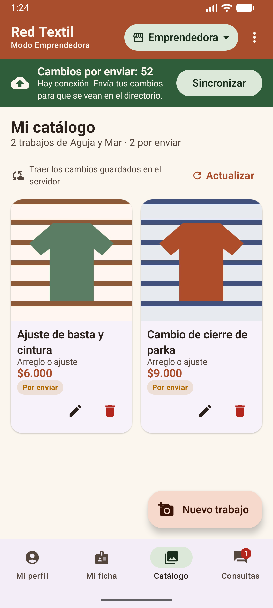
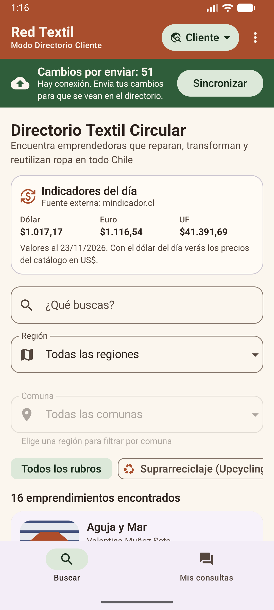
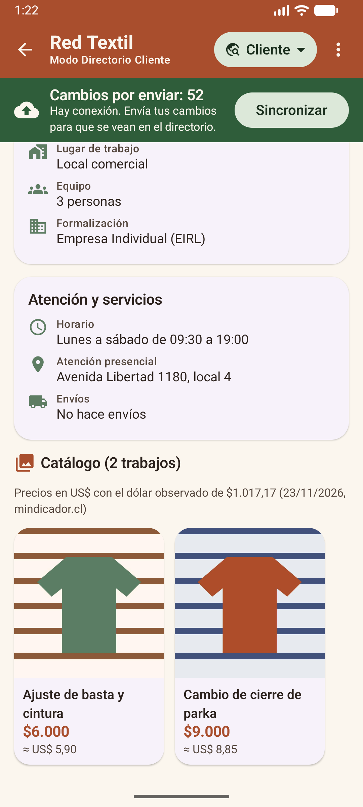
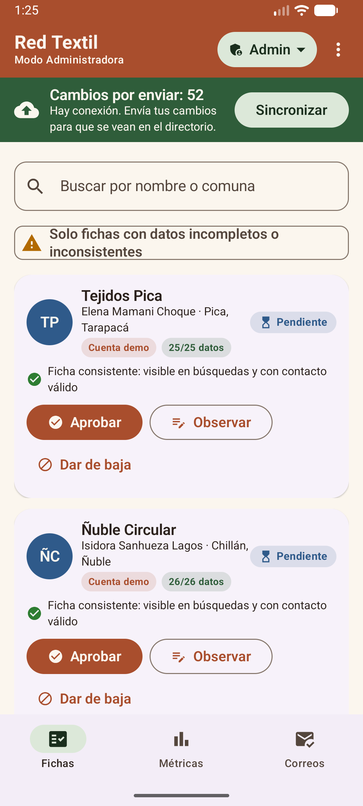

# Guía de uso de Red Textil Circular
La barra superior tiene un selector para cambiar entre tres perfiles.
## Modo Emprendedora

1. **Mi perfil:** elegir una cuenta demo (por ejemplo *Renace Textil*)
 o "Crear mi cuenta nueva".
2. **Mi ficha:** completar los datos en 5 secciones. Cada campo se valida al escribir:
 check verde si está bien, mensaje en rojo si hay un error.
3. **Catálogo:** "Nuevo trabajo" para subir una foto desde la cámara o la galería.
 Cada trabajo se puede editar o eliminar.
4. **Consultas:** "Actualizar" trae las consultas del servidor. Se pueden responder,
 marcar como pendientes o eliminar.
## Modo Directorio Cliente
 
1. **Buscar:** texto y filtros por región, comuna y rubro. Arriba está la tarjeta con
 el dólar, el euro y la UF del día (API externa mindicador.cl).
2. **Detalle:** galería de trabajos con el precio en pesos y en dólares, botones de
 WhatsApp e Instagram, y "Enviar consulta por formulario".
3. **Mis consultas:** las consultas enviadas desde el teléfono.
## Modo Administradora

1. **Fichas:** aprobar, observar con una nota o dar de baja. "Actualizar" trae las fichas
 del servidor y "Sincronizar Dataset Histórico (982 emprendimientos)" carga las antiguas.
2. **Métricas:** búsquedas y contactos por región y por rubro.
3. **Correos:** estado de los correos automáticos y reenvío de los que fallaron.
## Menú (tres puntos, arriba a la derecha)
- **Simular sin señal:** prueba el modo zona rural. Los cambios quedan guardados
 y se envían al volver la señal.
- **Sincronizar ahora:** envía al microservicio todo lo pendiente.
